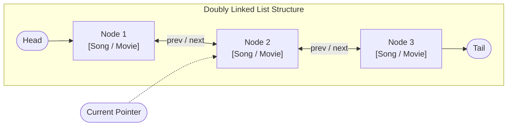

# 🎵 Custom Doubly Linked List Media Library & Playlist (C++17)

> **Advanced Data Structures & Polymorphism Implementation**: Handcrafted Doubly Linked Lists (`Node* prev <-> next`), Object-Oriented Polymorphism (`MediaItem` -> `Song`, `Movie`), Memory Leak Prevention (RAII Destructors), and File Serialization.

---

## 🏛️ Data Structure & Architecture Diagram



---

## 🌟 Key Engineering Highlights

1. **Handcrafted Doubly Linked List (`MediaList`)**:
   - Zero STL container dependency for the core playback queue (`vector`/`list` omitted intentionally to demonstrate pure algorithmic control).
   - Dynamic bi-directional navigation (`nextItem()`, `previousItem()`).
   - Constant-time insertions at tail ($O(1)$) and linear target deletions ($O(N)$).

2. **Polymorphic Media Model (`MediaItem`)**:
   - Pure virtual base class `MediaItem` with specialized implementations:
     - `Song`: Artist, duration, favorite flag.
     - `Movie`: Director, rating, duration, favorite flag.
   - Run-Time Type Information (RTTI) and dynamic downcasting (`dynamic_cast`) for category filtering.

3. **Memory Safety & RAII Cleanups**:
   - Explicit destructor `~MediaList()` systematically traversing the chain and deallocating dynamic memory (`delete temp->data; delete temp;`) to guarantee zero memory leaks.

4. **Multi-User Role Engine & Stream Persistence**:
   - Multi-user authentication via `users.txt`.
   - CSV stream serialization to `media.txt` ensuring playlist state persists between sessions.

---

## 🛠️ Build & Run

### Direct Build (g++)
```bash
g++ -std=c++17 -O2 -Wall -Wextra main.cpp -o MediaPlaylist
./MediaPlaylist
```

### CMake Build
```bash
mkdir build && cd build
cmake ..
cmake --build .
./MediaPlaylist
```
